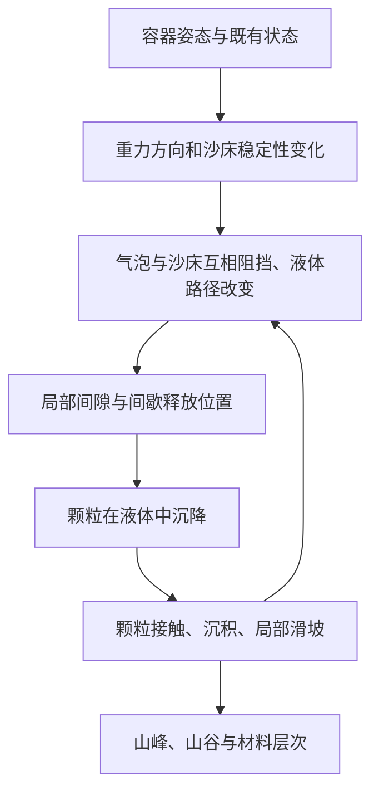

# 物理模型重审：从“落沙”回到三相薄腔流沙画

日期：2026-10-24。状态：研究结论与验证方案；不是已完成的新物理求解器。本文件修正原 PHYSICS_MODEL.md 的建模优先级。旧实现保留作工程基线，不代表实物原理已验证。

实施更新：E1 已有 SI 单位 CPU/GPU 稀相沉降求解器，E3 已有有限库存 CPU 接触床实验，见 [实验报告](../reports/EXPERIMENTS_E1_E3.md)。E2 已有[椭圆气泡候选](../reports/EXPERIMENT_E2.md)及[压力回流与保守输运实验](../reports/LIQUID_RETURNFLOW.md)，尚未组成完整物理或替换主应用。下文实验表的“当前状态”保留重审时记录。

## 1. 已确认的依据与未知项

| 来源 | 本次能支持的结论 | 不能支持的推断 |
|---|---|---|
| [KB/Sandman Airscale](https://sandpicture.com/airscale/?lang=en) | 官方说明将空气量与流速/形态联系：少些空气更快、偏沙丘，适量可形成缓慢山景，更多可能停流 | 不能直接推出所有气泡分布下流量严格单调，也没有给出材料/腔隙的数值参数 |
| [Sandman FAQ](https://sandpicture.com/faq/) | 官方介绍两玻璃间的水、沙、空气；沙先经过气泡层，不同沙存在沉降差异 | 页面简化语言中的“重量”不能直接换成颜色→密度固定表 |
| [IUPAC Stokes law](https://goldbook.iupac.org/terms/view/S06028/plain) | 低速球体相对流体运动的黏性阻力 | 不适用于未经条件检查的浓沙、非球形颗粒和强壁面约束 |
| [UVA Stokes law 课程](https://galileo.phys.virginia.edu/classes/152.mf1i.spring02/Stokes_Law.htm) | 稀相球体沉降可用重力/浮力/黏性阻力平衡分析 | 不能拿一个球的自由沉降解替代整幅流沙画 |
| [oomph-lib Young–Laplace 原始教程](https://oomph-lib.github.io/oomph-lib/doc/young_laplace/young_laplace/html/index.html) | 界面曲率、压差、表面张力及接触线边界共同决定静态界面 | 其针口/缝口算例不是流沙画实验；不能照搬阈值 |
| [Mutabaruka 等，PRE 89,052203](https://doi.org/10.1103/PhysRevE.89.052203) | 浸没颗粒床失稳可受孔隙压力、膨胀与接触结构影响 | 本次只读公开摘要，未读受限全文；文中具体堆积率不能用作 KB 的标定值 |

厂家网页获取间歇超时，上述产品性结论来自本次成功返回的网页/索引文本；没有测量视频或实物。尚未知：玻璃间隙、真实粒径分布、各矿物密度、液体黏度/配方、表面张力、润湿性和摩擦参数。不得编造这些值，也不能把其它品牌“黑沙比白沙重”的描述当成 KB 通用配方。

## 2. 正确的因果关系

流沙画是薄腔中的固体颗粒、液体和气体相互作用。翻转后，原有沙床处于不稳定方位，空气倾向上浮、沙倾向下沉；它们在受限空间里相遇，不是两个互不影响的透明图层。

这是建模因果框架，不是已测出的完整流场。气泡层如何支撑、变形和放行颗粒的具体闭合关系仍需实验；不能简化成“浮力足够大所以空气是硬墙”，也不能假设沙只会从绝不变化的孔洞穿过。润湿液膜、界面变形、气泡间液体通路都可能参与，现有证据不足以量化各项贡献。

山峰位置应由局部供沙通量及堆积响应决定；山脊不可由 renderer 或 director 指定。初始气泡分布可以有种子扰动，但后续泄流必须取决于当前几何与状态，而不是预设漏沙动画。

## 3. 必须分开的三个物理子问题

### 颗粒在液体中的沉降
稀相、低 Reynolds 数、球形且远离边界时，重力减浮力与 Stokes 阻力平衡给出：

`v_terminal = (rho_s-rho_l) g d² / (18 mu)`。

它说明粒径、密度差和黏度都重要，颜色不是动力学量。正式模型须保留材料参数与颜色的分离。薄腔壁阻、非球形、局部浓度和液体回流会改变有效速度，不能直接套用自由球解。流体可以先采用经过验证的有效阻力/准静态近似；不因此强制立即实现昂贵完整 CFD。

### 气泡与释放
静态单一气液界面满足 `p_g-p_l = gamma*(1/R1+1/R2)`（曲率符号约定一致）。玻璃间隙决定一个受限方向的曲率，二维图像里的圆弧不是完整三维曲率。这里不是有两层界面的肥皂泡，不能误用其 4 gamma/R。

候选简化模型要保存气体占据/界面或连通气泡几何、体积（或气体量与压力关系），并约束碰撞与位移；不能用少量自由上浮像素宣称已有功能气泡。气泡应能在沙床下受阻并改变局部释放。合并、拆分必须守恒，固定体积近似需明确，不应让泡泡被粒子覆盖后悄悄消失。

### 沙床接触与滑坡
自由沉降颗粒与已受支撑的沙床必须有不同规则。接触网络、局部坡度、有效摩擦决定是否滑动；浸没体系还可能有孔隙压力和膨胀反馈。可以先用经测量校准的静/动安息角近似，保留迟滞；它是模型假设，不是由一个方向夹角阈值自动得到的性质。

## 4. 现有代码的具体问题

1. `settle.glsl` 的材料 0 没有速度、压力或通量变量。改名“隐式液体”没有增加液体物理。
2. `projection > 6000*length1` 与沙堆坡面、接触支撑无关，不能称为已实现安息角。
3. 孤立粒子也可随机斜向落下。自由沉降与接触滑落没有分开，形成非物理的横向数值扩散。随机性应有物理对象，而不是给所有运动随意摇摆。
4. 每种颜色 210/155/105 的移动概率未由粒径/密度/黏度或实验标定。它能演示不同速率，但不能证明矿物分层正确。
5. 只有沙和空位交换，气体不存在，所以模型无法检验厂家描述的空气调节效果。
6. 每 tick 以 cell 为尺度移动，而没有物理长度/网格间距映射。同 tick 比较 256² 与 512² 不等于同物理时间、同物理速度的比较。
7. 此前 `app-settled` 截图仅取第 600 tick，没有静止检测；“最终盆形”不能据此断定。它证明当时观感不足，不证明最终稳态形状。

旧守恒测试是必要的数值安全条件，不能验证力学闭合正确。旧 GPU 与 CPU 一致，也可能只说明两边实现了同一个错误模型。

## 5. 下一版的候选数据架构（待实验选型）
保留四模块边界与 GPU 常驻数据。Physics Engine 内部拆分沉降、界面/释放和接触沉积；并非三个互不耦合的装饰效果。

- 颗粒：材料、粒径类、移动/接触状态；需要亚格位移或通量累计，避免低速度只能随机停走。
- 气体：可守恒的气相占据率/界面字段，或少量可变形气泡对象。两方案先做 E2 比较，不现在锁死实现。
- 液体：至少有可解释的有效阻力与排液/补液约束。是否加低分辨率速度/压力场由 E1/E2 失败证据决定；局部互换守恒不等价于已解不可压流动。
- 参数：物理空间尺寸、腔隙厚度、材料密度/粒径、黏度、界面与摩擦参数和算法版本。未知量标为假设/校准参数。

原地 2×2 可保留用于无竞争颗粒交换；界面曲率、接触支撑等邻域读取若跨块则须快照/ping-pong 或分阶段读写。不能只加 barrier 就假设同一 dispatch 跨块读取安全。最多一个在途包、低尺寸实验、无生产逐帧读回的约束继续有效。

## 6. 三个实验与进入条件

| 实验 | 控制与对照 | 测量与通过条件 | 当前状态 |
|---|---|---|---|
| E1 沉降柱 | 无气泡，孤立颗粒→稀相多粒→浓相；分别改变 d、密度差、mu、腔隙 | 孤立极限与解析解一致；静液竖直沉降无无由横漂；时间/网格收敛；浓相趋势需独立数据 | 解析极限数值检验通过；实际受限颗粒求解器未实现 |
| E2 气泡层漏沙 | 相同沙床、少/中/多气体；同气体量不同泡数；固定壁/固定孔洞只作对照 | Q(x,t)、首漏时刻、通道寿命、气体守恒；可保持又可间歇释放；气泡位置改变须真实改变供沙 | 仅单界面解析极限检查通过；动态功能气泡实验未实现 |
| E3 局部供沙成堆 | 无气泡，有限上方储沙库以可控位置放行；停供、改变供沙位置和倾斜底床 | 守恒、峰跟随供沙而非模板、稳定坡度范围、起滑/停止迟滞；停供后趋稳 | 已完成旧规则自由沉降负对照；新接触/成堆实验待实现 |

E3 中储沙库须计入总库存，不能用无计数的粒子喷射器冒充封闭系统。E2 固定孔洞测试是隔离变量的实验夹具，不能当成产品气泡模型。验收阈值中 E1 解析极限误差 <1% 为工程目标；真实山峰/漏流统计容差需有实物录像后确定，不伪造精度承诺。

先按 E1→E3→E2 的实现顺序隔离沉降与接触错误，再耦合三者；E2 是产品物理门槛，不能绕过。完成小实验后才能替换主应用规则。没有实物数据时只能标记“定性机制原型”，不能宣称匹配 KB。

## 7. 本轮已执行的诊断
运行 `python tests/physics_reassessment.py`，输出 reports/physics-reassessment.json。

- E1：示例 d=20 μm、rho_s=2650、rho_l=1000 kg/m³、mu=0.001 Pa·s 的自由球极限，Re≈0.007194。后向 Euler 随步长减小收敛到解析速度；终速约 0.3597 mm/s。参数只是教学对照，不是 KB 配方；瞬态忽略附加质量/历史力。
- E2：自由球形气液界面的能量/体积差分与 Laplace 压差相符；R=1 mm、gamma=0.072 N/m 时约 144 Pa。它只验证静态极限，绝不证明有气泡漏沙。
- E3 旧模型负对照：静止隐式介质、竖直重力、单粒子未接触底床，64 seeds×10 tick。每类有 54/64 个终点出现横移，横位移 RMS 为 3.72/3.15/2.36 cells。这里没有流场或碰撞来解释横漂，结果定位了更新规则自身的扩散。

主 shader 本轮未改。解析检验、旧模型反例、真实设备工程回归、实物验证必须分别报告。
